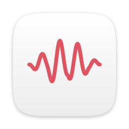

<p align="center">
  
</p>

<h1 align="center">Echo</h1>

<p align="center">
  Fast, native voice-to-text for macOS.
</p>

<p align="center">
  <a href="https://github.com/Rkaede/echo/releases/latest/download/Echo.dmg"><strong>Download for macOS 15+</strong></a>
  &nbsp;·&nbsp;
  <a href="https://github.com/Rkaede/echo/releases">Releases</a>
  &nbsp;·&nbsp;
  <a href="CHANGELOG.md">Changelog</a>
</p>

---

Tap `Fn` to dictate hands-free, or hold `Fn` for push-to-talk. Echo transcribes your speech with MAI-Transcribe-2 or Whisper through OpenRouter or Groq, optionally cleans it up with an LLM, and pastes it straight into your active app.

- **Native macOS menu bar app** built in Swift and SwiftUI — no Electron, no webviews
- **Bring your own API key** — no subscriptions, paywalls, tracking, or upsells
- **Open source** under the MIT License

## Features

### Dictation & Overlay
- **Minimal floating overlay** at the bottom of your active display — stays visible across Spaces and over full-screen apps, with a live audio waveform and active microphone indicator.
- **Tap or hold `Fn`** to switch seamlessly between hands-free toggle recording and push-to-talk, or start directly with a profile shortcut.
- **No phantom text** — silent or accidental recordings are dropped automatically so stock phrases like *"Thank you."* aren't pasted.
- **Clipboard restoration** — restores your previous clipboard contents after pasting (configurable in Settings).

### Profiles & LLM Clean-Up
- **Custom profiles** with their own transcription model, optional LLM clean-up model and prompt, icon, colour, and shortcut. Switch profiles mid-recording with arrow keys.
- **Safe clean-up by default** — prompts are sent as system instructions with your transcript as a separate user message, fixing punctuation, filler words, and misheard names without answering questions or following instructions you dictate.
- **Improve Prompt with an Agent** — click **Copy Instructions** in any profile's post-processing settings to copy a ready-to-paste prompt for Claude Code, Codex, or another coding agent. The agent inspects that profile's local history and suggests an improved clean-up prompt tailored to the names and terms you use.

### Notes Mode
- Toggle Notes Mode (`⌃⌥N` or from the menu bar) to dictate a sequence of notes instead of pasting each entry.
- **Automatic screenshots & screen drawing** — each recording captures a screenshot when you stop. Drag anywhere on screen while recording to draw annotations; the screenshot automatically crops to the area you marked.
- **Ready-to-share exports** — stopping opens a clean, light/dark-aware HTML page (and saves a Markdown copy) with three views: the full note with screenshots, the plain transcript, and an AI-cleaned version. Copy directly via **Copy HTML** (rich text with embedded screenshots for Gmail, Slack, or Teams), **Copy Markdown**, or **Copy Path**.

### Long Dictations & Reliability
- **Long recordings** — dictations over 10 minutes are split automatically at quiet pauses to stay under the 25 MB upload limit, and long transcripts are cleaned up section by section.
- **Retry Failed Recording** — if a transcription fails due to a network or API error, Echo keeps the last three recordings locally so you can retry from the menu bar without losing what you said.
- **Audio controls** — set a preferred and fallback microphone, tune how long the audio engine stays warm between recordings, and get automatic updates via Sparkle.

### History & Synthesized Sounds
- **Local history** — optional SQLite history with full-text search, a switch between cleaned and raw transcripts, per-dictation metadata, and optional saved audio playback.
- **Synthesized cues** — twelve recording cues across four styles (*Default*, *Mechanical*, *Bubble*, *Press*) synthesized natively with [Cuelume](https://github.com/danielwh2/cuelume).

## Getting Started

### Requirements
- **macOS 15.0** or later
- An **OpenRouter API key** ([openrouter.ai/keys](https://openrouter.ai/keys)) — one key covers both transcription and clean-up
- *Optional:* a **Groq API key** ([console.groq.com/keys](https://console.groq.com/keys)) to run Whisper and GPT OSS 20B directly on Groq (~100–300 ms faster per dictation)

### Setup
1. Download [`Echo.dmg`](https://github.com/Rkaede/echo/releases/latest/download/Echo.dmg) (or choose a version from the [releases page](https://github.com/Rkaede/echo/releases)) and drag **Echo** to your **Applications** folder.
2. Open Echo and walk through setup: paste your OpenRouter API key and pick the **Accurate** or **Fast** preset.
3. Grant **Microphone** and **Accessibility** permissions when prompted. *(Screen Recording is optional and only requested when you use Notes Mode.)*
4. Try a test dictation right in setup, then press `Fn` in any app.

To add a Groq API key later, open **Settings › Providers**.

## Models & Costs

OpenRouter and Groq are pay-as-you-go services. For most people, everyday dictation costs roughly **$1–$2/month**.

### Setup Presets

Both presets run through OpenRouter out of the box and can be customized per profile in **Settings › Profiles**.

| Preset | Transcription | Clean-Up | Languages | Error Rate | Typical Wait | Est. Cost |
| --- | --- | --- | --- | --- | --- | --- |
| **Accurate** *(recommended)* | MAI-Transcribe-2 | Gemini 3.5 Flash-Lite | English | 4.63% | ~1.5–1.8 s | ~13¢ / hour |
| **Fast** | Whisper Large V3 Turbo | GPT OSS 20B | Multilingual | 6.95% | ~1.3–1.6 s | ~4¢ / hour |

*Error rates, wait times, and costs are measured on pasted text via OpenRouter. Calling Groq directly with a Groq key trims roughly 100–300 ms from Whisper and GPT OSS 20B requests.*

### Available Models

**Transcription**

| Model | Provider | Languages | Cost | Notes |
| --- | --- | --- | --- | --- |
| **MAI-Transcribe-2** | OpenRouter | English | ~$0.10 / hr | Cleanest punctuation and lowest error rate; automatically falls back to Whisper Turbo if slow or unavailable |
| **Whisper Large V3 Turbo** | OpenRouter or Groq | Multilingual | $0.04 / hr | Fast, low-cost multilingual transcription |
| **Whisper Large V3** | OpenRouter or Groq | Multilingual | $0.111 / hr | Higher-accuracy multilingual transcription and translation |

**Clean-Up**

| Model | Provider | Notes |
| --- | --- | --- |
| **Gemini 3.5 Flash-Lite** | OpenRouter | Most accurate with names and technical terms (~0.65 s) |
| **GPT OSS 20B** | Groq or OpenRouter | Fastest clean-up (~0.4 s direct on Groq) |

*Note: Groq bills a 10-second minimum duration per transcription request.*

## Shortcuts

| Action | Shortcut | Details |
| --- | --- | --- |
| Hands-free recording | Tap `Fn` | Release within 300 ms to keep recording; press `Fn` again to stop |
| Push-to-talk | Hold `Fn` | Hold for 300 ms or longer; release to stop |
| Cancel recording | `Esc` | Cancels immediately in push-to-talk; press twice to confirm in hands-free mode |
| Start/stop a profile | Custom *(default: `⌥Space` for General Dictation)* | Configurable per profile in **Settings › Shortcuts** |
| Switch profile while recording | `←` / `→` | Configurable in **Settings › Shortcuts**; skips profiles without an API key |
| Toggle Notes Mode | `⌃⌥N` | Configurable in **Settings › Shortcuts** |

> [!TIP]
> If pressing `Fn` opens the macOS Emoji picker or system dictation, adjust what the Globe (`Fn`) key does in **System Settings › Keyboard**.

## Privacy

> [!IMPORTANT]
> Echo sends your audio to a cloud provider for transcription, and sends the transcript too when LLM clean-up is enabled. If you need fully offline transcription, consider a local alternative such as Superwhisper.

- **OpenRouter**: Echo sends audio and transcripts to OpenRouter, which routes requests to the selected model's host (Whisper and GPT OSS 20B through OpenRouter are routed to Groq). Review [OpenRouter's Privacy Policy](https://openrouter.ai/privacy).
- **Groq**: Audio and transcripts are sent directly to Groq. Review [Groq's Privacy Policy](https://groq.com/privacy-policy) and this [community post](https://community.groq.com/help-center-14/how-does-groq-handle-my-data-190) regarding data retention.

**What Echo does locally:**
- Stores your OpenRouter and Groq API keys in the **macOS Keychain** (never in plain text).
- Writes temporary WAV recordings to `/tmp/echo/` and deletes them after processing. If transcription fails, Echo keeps up to the three most recent failed recordings in Application Support so you can retry them from the menu bar.
- Keeps **History** off by default. When enabled, raw and cleaned transcripts (and optionally audio files) are stored in a local SQLite database. Using **Copy Instructions** gives the coding agent you paste it into the path to that local database.
- Uses **Accessibility** for global shortcuts and simulating `⌘V` to paste into the active app, and **Screen Recording** only for Notes Mode screenshots.

## Troubleshooting

- **No transcription or API error:** Confirm your API key for the active profile's provider (OpenRouter or Groq) is saved in **Settings › Providers**.
- **Auto-paste or `Fn` shortcut not working:** Verify **Accessibility** is enabled in **Settings › Permissions**, and check **System Settings › Keyboard** for conflicting Globe (`Fn`) actions.
- **Overlay not visible:** The overlay appears at the bottom center of the active display. Focus any app window and press the recording shortcut again.
- **Still stuck?** Open **Settings › General › Open Logs Folder** to inspect diagnostic logs (including console and CoreAudio output) and include them when filing an issue.

## Building from Source

Requires **macOS 15.0+** and **Xcode**.

```bash
git clone https://github.com/Rkaede/echo.git
cd echo
open Echo.xcodeproj
```

Or build and test from the command line:

```bash
xcodebuild -scheme Echo -configuration Debug build
xcodebuild -scheme Echo test
```

## Acknowledgments

- Recording sound effects are synthesized using a Swift port of [Cuelume](https://github.com/danielwh2/cuelume) by Daniel Belyi (MIT License).
- Automatic updates are powered by [Sparkle](https://sparkle-project.org/).

## Contributing

Issues and pull requests are welcome. When reporting a bug, please include your macOS version, Echo version, reproduction steps, and relevant logs from **Settings › General › Open Logs Folder**.

## License

[MIT](LICENSE)
